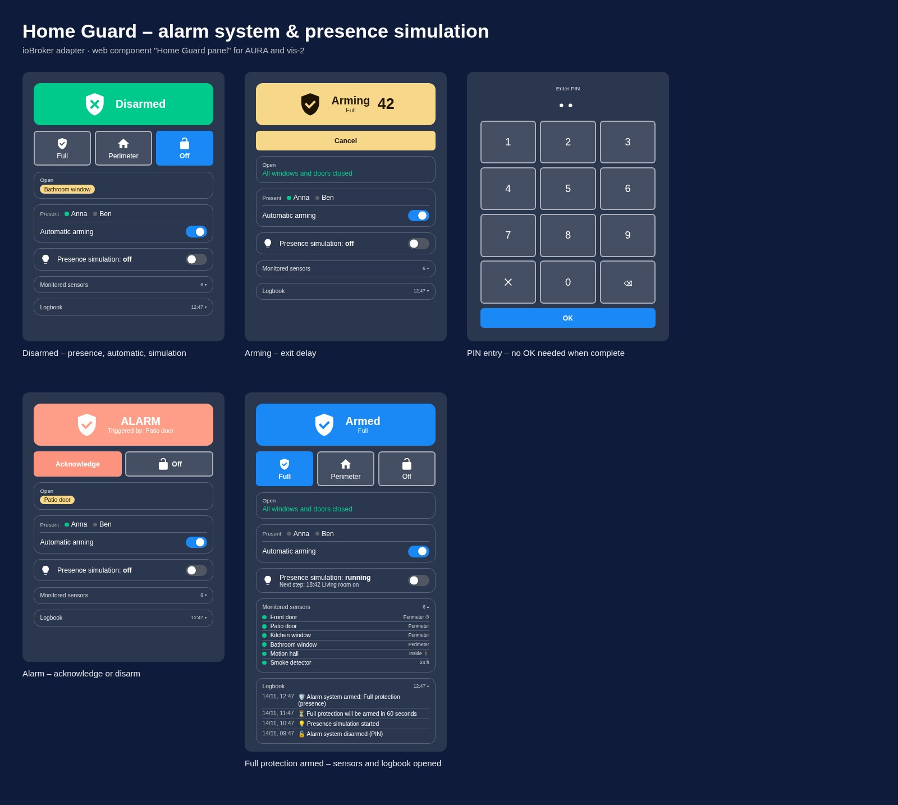

# ioBroker.home-guard

[](https://www.npmjs.com/package/iobroker.home-guard)
[](https://www.npmjs.com/package/iobroker.home-guard)


[](https://nodei.co/npm/iobroker.home-guard/)

**Tests:** 

## Home Guard adapter for ioBroker

**Deutsche Anleitung: [README.de.md](README.de.md)**

Home Guard is an alarm system and a presence simulation in one adapter. Both parts can be used on their own or together.



### Highlights

- **Setup assistant**: a new instance starts with a guided setup. First it asks what you want to use (alarm system, presence simulation, evening and morning light) and what you already have (door and window contacts, motion and smoke detectors, siren, door lock, presence detection, speaker …) – *Search automatically* looks through your ioBroker and ticks what it finds. After that only the pages that fit your answers follow: one topic each, explained in plain words, with suggested times and a check at the end ("no messenger", "no door delayed" …). If you know your way around, skip it with one tick.

  

- **Automatic sensor search** – also without functions: sensors are found by their role, by the Homematic device type and by the state names of Zigbee, deCONZ, Hue and Shelly. Found sensors are listed unticked in the sensor table with room, name and a note (current value, camera, no report for 30+ days) – tick what you want to use. Aliases win over their targets, thermostat windows and disabled adapters are left out.

- **Three modes**: full protection (all sensors), perimeter protection (doors and windows only, you are at home) and night protection (perimeter, armed automatically at night). Doors and windows you open at home (e.g. the bedroom window) can be ignored in perimeter and night protection. 24 h sensors (smoke, water) always trigger.
- **Exit delay** per mode, **arming at once** when the front door closes, **entry delay** (silent alarm) for delayed sensors such as the front door.
- **Open window check** when arming: warn and arm anyway, refuse, ignore, or **bypass** – open contacts are left out and watched again as soon as they are closed. Tilted windows (value 1) count as open; with **"tilted is OK"** per window handle (0 = closed, 1 = tilted, 2 = open) tilted is no alarm in perimeter and night protection, fully open still is.
- **Motion detectors** trigger only when several different detectors report within a set time (default 120 s) – a cat or a curtain alone is no alarm. During the entry delay the inside sensors follow: walking past motion detectors to the panel is no alarm.
- **PIN** (stored encrypted), optionally also needed for arming; report after wrong entries and lock of the PIN entry for some minutes against trying out. Optional **duress PIN**: disarms like the PIN, but sends a silent alarm to the messengers.
- **Door lock** (e.g. Nuki) disarms when it is opened, **presence** (persons, phones) arms when the last one leaves and disarms full protection when somebody comes home. **After disarming without presence** the presence simulation stops at once; choose whether it stays off until the system is armed again (default), may run again after some minutes, or the system arms itself again after some minutes when the presence detection still says nobody is at home.
- **Notifications** directly to Telegram, e-mail, Pushover, Pushsafer, Gotify, WhatsApp and Signal (CallMeBot), SMS (gsmsms, seven.io), Discord, MAX, the ioBroker Visu app (iot) and Synology Chat – each in its own format with the fields it needs; only installed messengers are offered; additionally to the notification manager itself; repeating alarm message until acknowledged; **speech output** (e.g. Alexa, SayIt).
- **On alarm**: lamps on or blinking (and back as before afterwards), sirens, any states through an actions table – devices, scenes, scripts (e.g. outdoor lights on, lock the door when armed, roller shutters down, camera recording).
- **Sabotage check**: sensors that have not reported for a set number of hours are reported (empty battery, radio problem).
- **Presence simulation** with three ways of planning: *dusk* (random times around sunset, lights out around a set time, later on Friday/Saturday, short visits to hall and bath), *learned* (replays a real day learned from your own switching, with shifted times – any weekday for a weekday evening, any Friday/Saturday for the weekend; optionally the same day of the week when at least 3 of them are learned) and *combined* (recommended).
- **Evening light**: the evening lamps every evening, also when somebody is at home – at dusk all on (also those switched off by hand the evening before), at "lights out" all off (also those switched on by hand). Short visits, bedtime and learned switching only while the simulation runs. Switching on and off can be turned on or off separately at any time (e.g. on automatically, off by hand) – with `control.eveningOn`/`eveningOff`/`morningOn`/`morningOff` or the switches in the panel.
- **TV and other devices, scenes or scripts** in the simulation (type "Device / scene / script"), only while the simulation runs: with "Learn from" (e.g. the real power state of the TV) your real evenings are replayed, also several times an evening; without, it runs a set number of times for a random time – per device **in the evening** (dusk to lights out), **the whole day** (wake-up to lights out) or at **own times**, with its own count (also a range like 1-3 = random each day) and duration. An own value for on and off lets a scene of the scenes adapter or a script do several steps (TV on, then a channel).
- **Amazon Echo (Alexa)** when the alexa2 adapter is installed – set per Echo and per use: **on alarm** volume, an alarm sound of Amazon's sound library and the alarm read aloud (as an addition to a real siren, while the alarm runs; also in the test alarm); **as radio in the simulation** with a fixed station or a random one of several (name or TuneIn ID), own volume, time window, count and duration – and, if wanted, learned when radio or music really plays at your place (from 5 minutes; answers to questions do not count). The setup assistant finds the Echos and asks what you want to use them for.
- **When the simulation ends** (e.g. coming home): per entry automatic (devices like the TV off, lamps stay on), switch off or leave on. Entries in the tables override the ones found through a function.
- **Learning window**: learn and replay only when it is dark (from shortly before sunset to sunrise), between two times or always.
- **Danger detectors** (smoke, water, gas – 24 h sensors) report always, also when disarmed; per sensor: message only, message and speech output, or a full alarm with sirens, lamps and actions. Own event "danger detector" for the actions table (e.g. close a water valve).
- **Report-only sensors** (garden gate, letter box, shed): a message instead of an alarm, only while armed or always; switchable at any time with `control.report`.
- **Sirens per mode**: every alarm, full protection only (outside siren) or perimeter/night only (inside siren), each with its own duration.
- **Morning light**: the morning lamps on at wake-up time (later on the weekend) and off after sunrise (own offset and random delay, optionally at the latest at a set time – e.g. when you leave the house – or as soon as the brightness sensor reports daylight) – during the simulation, or every morning like the evening light; with learned days the real mornings are replayed.
- **Test alarm** in the settings (tab *Actions & test*): tick what is really switched (notifications, speech, lamps, sirens, actions), with a question before and marked as a test – no arming, no real alarm, afterwards everything back as before.
- **Walk test** (tab *Actions & test* or `control.walkTest`): while disarmed, open every door and window and walk past every motion detector – in the settings a live list shows every sensor with a red cross that turns into a green tick as soon as it reports; below the sensors the door lock (if set up) shows its current state live – it does not count; when all are green the test ends by itself, otherwise it tells you which ones stayed silent (result also in `status.walkTest`).
- **Restart during an alarm**: the alarm stays until acknowledged, sirens are switched off.
- **Widget "Home Guard panel"** (web component) for AURA, vis-2 and other visualisations that support web components: status, mode buttons, PIN keypad, open windows, who is at home (optional), switch for automatic arming, switches for the evening/morning light, monitored sensors and a logbook to open.

### Requirements

- Node.js 22 or newer, js-controller 6.0.11 or newer, admin 7.6.20 or newer
- Widget: AURA 0.106.0 or newer, vis-2 2.20.7 or newer, or another visualisation that supports web components

### Configuration

**Setup assistant:** when the settings are opened for the first time, the setup assistant guides you through everything needed (see Highlights). Once you tick *Setup finished – show all settings* on the last page – or choose *No – I set it up myself* right on the first page – the tabs with every detail setting appear. The assistant stays reachable as the first tab; instances that were set up before keep showing the tabs directly.

The tabs of the settings:

1. **General** – switch the alarm system and the presence simulation on or off.
2. **Triggers** – choose functions for perimeter (doors, windows), full protection (inside, motion) and 24 h sensors, or list sensors by hand (with *delayed*, *inverted* and *motion detector* flags). Any device type works – also glass break or vibration detectors or a panic button; a row in the table overrides or excludes a sensor from a function.
3. **Procedure & PIN** – exit and entry delays, front door contact for arming at once, open window check, alarm duration, PIN, night protection times.
4. **Lock & presence** – door lock state and the values meaning "unlocked" (Nuki: 3, 5, 6), presence states and what happens when everybody leaves or somebody comes home.
5. **Notifications** – messenger instances, which events are reported, speech output state.
6. **Actions & test** – lamps (function or list, on or blinking), sirens, an actions table for any event and the test alarm.
7. **Presence simulation** – simulation, evening and morning light: functions for evening and morning lamps, a table of lamps with the roles *evening*, *morning*, *short visits*, *bedtime* (several per lamp) and devices/scenes/scripts, way of planning, start relative to sunset or below a lux value, lights out, learning. Devices get a time window per row (evening, whole day, own times), count and duration.
8. **Alexa** – Echo devices for the alarm (volume, alarm sound, announcement) and as radio in the simulation (station, volume, time window, count, duration, learning), each per device.

### Function or table – what can be set up how

Many things can be picked up through a **function** (enum) – every state that is a member of the function is used, and new members are picked up without a restart. Some settings only exist per entry, so these things must be **entered by hand in the table** (with the state ID). An entry in a table overrides the same state found through a function.

| What | Through a function | Only in the table |
|---|---|---|
| Sensors – perimeter, inside, danger detector, report-only | ✓ one function each | *delayed* (entry delay), *inverted*, *motion detector*, what a danger detector does (message / speech / alarm) |
| Presence (who is at home) | ✓ | one name for several states of one person (e.g. GPS and ping) – without a name the object name is used |
| Lamps on alarm | ✓ | – |
| Sirens | – | ✓ (mode *every alarm / full only / perimeter–night only* and duration per siren) |
| **Evening lamps** | ✓ function *evening light* | ✓ tick *Evening* |
| **Morning lamps** | ✓ function *morning light* (may be the same function) | ✓ tick *Morning* |
| Lamps for **short visits** and **bedtime** | – | ✓ tick *Short visits* / *Bedtime* |
| **Device / scene / script** in the simulation | – | ✓ (own values for on/off, *learn from*, what happens when the simulation ends) |
| Actions (lock the door, shutters, camera …) | – | ✓ |

A lamp in the table can have several roles at once (e.g. the kitchen as evening and morning lamp). Example: the hall and bathroom lights for short visits during the simulation are entered in the table with *Short visits* ticked; they are not part of the function of the evening lamps, otherwise they would be on all evening.

### States

| State | Meaning |
|---|---|
| `status.mode` | `off`, `full`, `perimeter`, `night` |
| `status.phase` | `disarmed`, `arming`, `armed`, `entry`, `alarm` |
| `status.text` | status as text |
| `status.armed`, `status.alarm`, `status.entry` | flags |
| `status.countdown` | seconds of the running exit/entry delay |
| `status.openContacts`, `status.openCount` | open doors/windows |
| `status.bypassed` | open contacts left out at arming until they are closed |
| `status.walkTest` | walk test: running, reported and silent sensors (JSON) |
| `status.arrived` | somebody came home (disarmed): the simulation stays off until armed again or somebody leaves |
| `status.walkTestHtml` | walk test as a list for the settings page (HTML) |
| `status.readyFull`, `status.readyPerimeter` | arming possible without open contacts |
| `status.lastTrigger`, `status.lastTriggerTime` | last sensor that triggered |
| `status.wrongPin` | wrong PIN entries in a row |
| `status.sabotage` | sensors without reports (JSON) |
| `status.sensors` | monitored sensors (JSON) |
| `status.presentCount`, `status.someoneHome` | persons at home, someone at home |
| `status.present` | persons and whether they are at home (JSON) – several states of one person (GPS, ping) count as one |
| `status.log` | logbook (JSON) |
| `control.mode` | set the mode (`off`, `full`, `perimeter`, `night`) |
| `control.full`, `control.perimeter`, `control.night`, `control.off` | buttons |
| `control.cancel`, `control.ack`, `control.panic` | cancel arming, acknowledge alarm, panic alarm |
| `control.pin` | write the PIN to disarm |
| `control.ackPin` | write the PIN to acknowledge a running alarm – sirens, lights and Echos stop, the system stays armed |
| `control.report` | report-only sensors on/off |
| `control.eveningOn` / `control.eveningOff` | evening light: switch on / off automatically (also switches in the panel; "on" switched on in the evening: the lamps go on at once) |
| `control.morningOn` / `control.morningOff` | morning light: switch on / off automatically |
| `control.autoArm` | automatic arming/disarming by presence on/off (also a switch in the panel) |
| `control.walkTest` | start (true) or stop (false) the walk test |
| `simulation.active` | simulation is running |
| `simulation.next`, `simulation.plan` | next step and plan of the evening |
| `simulation.learned`, `simulation.learnedDays` | learned days |

If *Disarm by state only with the PIN* is set, `control.mode` and `control.off` cannot disarm – only `control.pin`, the panel or the door lock.
If *Acknowledge only with the PIN* is set, `control.ack` is refused – use `control.ackPin`, the panel or `sendTo(… 'ack', { pin })`. Both PIN states empty themselves at once; wrong entries count towards the PIN lock.

### Operating with states (without the widget)

Everything the panel does also works with the states under `home-guard.0.control` – in the admin (tab *Objects*: click the value, enter it, save), in Blockly ("control" block), in a JavaScript script or with a button in any visualisation. Buttons take `true` and go back to `false` by themselves; the PIN states empty themselves at once, so the PIN never stays visible.

| What | State and value |
|---|---|
| Full protection | `control.full` = `true` (or `control.mode` = `full`) |
| Perimeter protection | `control.perimeter` = `true` (or `control.mode` = `perimeter`) |
| Night protection | `control.night` = `true` (or `control.mode` = `night`) |
| Cancel arming (exit delay running) | `control.cancel` = `true` |
| Disarm with the PIN | `control.pin` = your PIN, e.g. `1234` – also ends a running alarm |
| Disarm without the PIN | `control.off` = `true` (or `control.mode` = `off`) – only if *Disarm by state only with the PIN* is **off** |
| Acknowledge the alarm with the PIN | `control.ackPin` = your PIN – sirens, lights and Echos stop, the system **stays armed** |
| Acknowledge without the PIN | `control.ack` = `true` – only if *Acknowledge only with the PIN* is **off** |
| Panic alarm | `control.panic` = `true` |

What happened is shown in the `status` states: `status.mode` and `status.phase` (`disarmed`, `arming`, `armed`, `entry`, `alarm`), `status.countdown` (seconds of the exit or entry delay), `status.alarm`, `status.openContacts` (what is still open), `status.wrongPin` (wrong entries in a row) and `status.text` (the last message). A refused command (wrong PIN, PIN locked, button not allowed by the settings) changes nothing and is written to the ioBroker log.

```js
setState('home-guard.0.control.full', true);       // arm full protection
setState('home-guard.0.control.pin', '1234');      // disarm with the PIN
setState('home-guard.0.control.ackPin', '1234');   // acknowledge the alarm with the PIN, stays armed
on({ id: 'home-guard.0.status.phase', change: 'ne' }, obj => log(`Home Guard: ${obj.state.val}`));
```

With *PIN also for arming* switched on, arming by state is refused – then arm in the panel or with `sendTo` (see below).

### Scripts (sendTo)

```js
sendTo('home-guard.0', 'arm', { mode: 'full' }, res => log(JSON.stringify(res))); // { ok, open: [...] }
sendTo('home-guard.0', 'arm', { mode: 'perimeter', pin: '1234' });               // pin only when "arming also needs the PIN"
sendTo('home-guard.0', 'disarm', { pin: '1234' });
sendTo('home-guard.0', 'cancel', {});      // cancel the exit delay
sendTo('home-guard.0', 'ack', {});         // acknowledge the alarm
sendTo('home-guard.0', 'ack', { pin: '1234' }); // with "Acknowledge only with the PIN"
sendTo('home-guard.0', 'panic', {});
sendTo('home-guard.0', 'testAlarm', { notify: true, lamps: true, sirens: false, duration: 15 }, res => log(res.result));
sendTo('home-guard.0', 'status', {}, status => log(JSON.stringify(status)));
```

### Widget (web component)

After the installation, the "Home Guard panel" is in the widget list of AURA, vis-2 and every other visualisation that supports web components. Choose the instance; it shows status, countdown, mode buttons, PIN keypad, open windows, switches for the evening/morning light (only when set up) and logbook. **In AURA set "Clicks" of the widget to "component"** (`wcClick: "component"`), otherwise the buttons get no clicks.

### Note

Home Guard is a home automation helper, not a certified alarm system. It depends on ioBroker, the network and the sensors running.

## Changelog
<!--
	Placeholder for the next version (at the beginning of the line):
	### **WORK IN PROGRESS**
-->
### **WORK IN PROGRESS**
* (ipod86) new: option "Acknowledge only with the PIN" and state `control.ackPin` (write the PIN to acknowledge) – off by default; without it the message says clearly that the system stays armed; the setup assistant explains acknowledging and switching off in detail
* (ipod86) after acknowledging an alarm while armed, the next sensor triggers at once (no new entry delay)
* (ipod86) new: further sensors during a running alarm are reported once each (message, logbook) and the Echos announce all of them; the alarm duration now names sirens, Echos and lamps; new option "Sound again when another sensor triggers" (after the alarm duration, once per sensor)
* (ipod86) new: "Test alarm sound" button for every Echo (Echo table and tab Actions & test)
* (ipod86) fix: Echo alarm sounds really play now (Amazon routine sounds instead of SSML audio); volume is set back afterwards; mostly siren (3× before and after the announcement), rounds follow without a pause, default volume 100, a replacement sound if Amazon removes the chosen one
* (ipod86) fix: walk test errors logged in English, zh-cn text translated, unused translations removed

### 0.5.2 (2026-11-25)
* (ipod86) fix: clearer texts in the settings and the setup assistant; hints name the pages as the page list does

### 0.5.1 (2026-11-25)
* (ipod86) change: setting "after disarming without presence" – new name, only shown when persons are set up
* (ipod86) change: walk test – the door lock is shown below the sensors with its current state and no longer counts

### 0.5.0 (2026-11-25)
* (ipod86) feat: walk test – the door lock is its own check point (unlock once)
* (ipod86) feat: setting "after disarming": simulation off until armed again (default), simulation again after some minutes, or arm again after some minutes when nobody is at home
* (ipod86) fix: the presence simulation (lamps, TV, Echo radio) stops at once when the system is disarmed, not only when the presence detection notices
* (ipod86) feat: walk test with a live list in the settings (red cross turns into a green tick)

### 0.4.0 (2026-11-20)
* (ipod86) feat: "tilted is OK" per window handle, bypass open contacts when arming, duress PIN, walk test
* (ipod86) fix: setup assistant – sensor rows without a tick no longer count as "already set up"; the automatic search ticks the matching question instead

### 0.3.4 (2026-11-20)
* (ipod86) fix: review findings – logs in English only, failures of background tasks are logged, texts of the setup assistant and the test alarm in all admin languages, corrected translations
* (ipod86) change: admin – wide tables (sensors, lamps, Echos, messengers) as cards, reaction only for danger detectors, Alexa page in the assistant also for Echos already set up, clearer texts

### 0.3.3 (2026-11-20)
* (ipod86) feat: new column "ignore at home" in the sensor table – doors and windows you open at home (e.g. the bedroom window) are ignored in perimeter and night protection, with an info log line when opened

### 0.3.2 (2026-11-19)
* (ipod86) feat: automatic search also finds sensors without functions and lists them unticked in the sensor table
* (ipod86) feat: notification tab shows the status of the notification manager
* (ipod86) change: shorter messenger settings
* (ipod86) fix: better detection in the search (aliases, door locks, contacts, doorbells, thermostat windows)

Older changelogs are available in [CHANGELOG_OLD.md](CHANGELOG_OLD.md).

## License
MIT License

Copyright (c) 2026 ipod86 <david@graef.email>

Permission is hereby granted, free of charge, to any person obtaining a copy
of this software and associated documentation files (the "Software"), to deal
in the Software without restriction, including without limitation the rights
to use, copy, modify, merge, publish, distribute, sublicense, and/or sell
copies of the Software, and to permit persons to whom the Software is
furnished to do so, subject to the following conditions:

The above copyright notice and this permission notice shall be included in all
copies or substantial portions of the Software.

THE SOFTWARE IS PROVIDED "AS IS", WITHOUT WARRANTY OF ANY KIND, EXPRESS OR
IMPLIED, INCLUDING BUT NOT LIMITED TO THE WARRANTIES OF MERCHANTABILITY,
FITNESS FOR A PARTICULAR PURPOSE AND NONINFRINGEMENT. IN NO EVENT SHALL THE
AUTHORS OR COPYRIGHT HOLDERS BE LIABLE FOR ANY CLAIM, DAMAGES OR OTHER
LIABILITY, WHETHER IN AN ACTION OF CONTRACT, TORT OR OTHERWISE, ARISING FROM,
OUT OF OR IN CONNECTION WITH THE SOFTWARE OR THE USE OR OTHER DEALINGS IN THE
SOFTWARE.