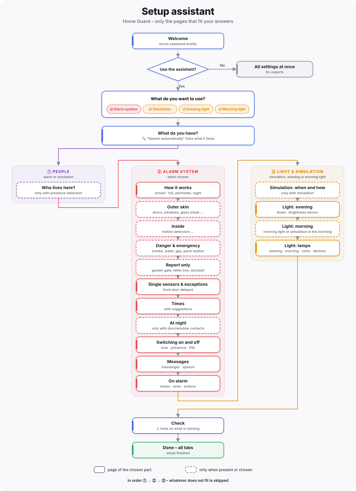

# ioBroker.home-guard

[](https://www.npmjs.com/package/iobroker.home-guard)
[](https://www.npmjs.com/package/iobroker.home-guard)


[](https://nodei.co/npm/iobroker.home-guard/)

**Tests:** 

## Home Guard adapter for ioBroker

**Deutsche Anleitung: [README.de.md](README.de.md)**

Home Guard is an alarm system and a presence simulation in one adapter. Both parts can be used on their own or together.


### Highlights

- **Setup assistant**: a new instance starts with a guided setup. First it asks what you want to use (alarm system, presence simulation, evening and morning light) and what you already have (door and window contacts, motion and smoke detectors, siren, door lock, presence detection, speaker …) – *Search automatically* looks through your ioBroker and ticks what it finds. After that only the pages that fit your answers follow: one topic each, explained in plain words, with suggested times and a check at the end ("no messenger", "no door delayed" …). If you know your way around, skip it with one tick.

  

- **Three modes**: full protection (all sensors), perimeter protection (doors and windows only, you are at home) and night protection (perimeter, armed automatically at night). 24 h sensors (smoke, water) always trigger.
- **Exit delay** per mode, **arming at once** when the front door closes, **entry delay** (silent alarm) for delayed sensors such as the front door.
- **Open window check** when arming: warn and arm anyway, refuse, or ignore. Tilted windows (value 1) count as open.
- **Motion detectors** trigger only when several different detectors report within a set time (default 120 s) – a cat or a curtain alone is no alarm. During the entry delay the inside sensors follow: walking past motion detectors to the panel is no alarm.
- **PIN** (stored encrypted), optionally also needed for arming; report after wrong entries and lock of the PIN entry for some minutes against trying out.
- **Door lock** (e.g. Nuki) disarms when it is opened, **presence** (persons, phones) arms when the last one leaves and disarms full protection when somebody comes home.
- **Notifications** to Telegram, Pushover, e-mail, WhatsApp (cmb), Signal (cmb) and Pushsafer in their own format, and to **every messenger that supports ioBroker notifications** (e.g. Gotify, Discord, ioBroker.pro app, GSM-SMS) in the format of the notification manager; additionally to the notification manager itself; repeating alarm message until acknowledged; **speech output** (e.g. Alexa, SayIt).
- **On alarm**: lamps on or blinking (and back as before afterwards), sirens, any states through an actions table – devices, scenes, scripts (e.g. outdoor lights on, lock the door when armed, roller shutters down, camera recording).
- **Sabotage check**: sensors that have not reported for a set number of hours are reported (empty battery, radio problem).
- **Presence simulation** with three ways of planning: *dusk* (random times around sunset, lights out around a set time, later on Friday/Saturday, short visits to hall and bath), *learned* (replays a real day learned from your own switching, with shifted times – any weekday for a weekday evening, any Friday/Saturday for the weekend; optionally the same day of the week when at least 3 of them are learned) and *combined* (recommended).
- **Evening light**: the evening lamps every evening, also when somebody is at home – at dusk all on (also those switched off by hand the evening before), at "lights out" all off (also those switched on by hand). Short visits, bedtime and learned switching only while the simulation runs. Switching on and off can be turned on or off separately at any time (e.g. on automatically, off by hand) – with `control.eveningOn`/`eveningOff`/`morningOn`/`morningOff` or the switches in the panel.
- **TV and other devices, scenes or scripts** in the simulation (type "Device / scene / script"), only while the simulation runs: with "Learn from" (e.g. the real power state of the TV) your real evenings are replayed, also several times an evening; without, it runs a set number of times for a random time. An own value for on and off lets a scene of the scenes adapter or a script do several steps (TV on, then a channel).
- **When the simulation ends** (e.g. coming home): per entry automatic (devices like the TV off, lamps stay on), switch off or leave on. Entries in the tables override the ones found through a function.
- **Learning window**: learn and replay only when it is dark (from shortly before sunset to sunrise), between two times or always.
- **Danger detectors** (smoke, water, gas – 24 h sensors) report always, also when disarmed; per sensor: message only, message and speech output, or a full alarm with sirens, lamps and actions. Own event "danger detector" for the actions table (e.g. close a water valve).
- **Report-only sensors** (garden gate, letter box, shed): a message instead of an alarm, only while armed or always; switchable at any time with `control.report`.
- **Sirens per mode**: every alarm, full protection only (outside siren) or perimeter/night only (inside siren), each with its own duration.
- **Morning light**: the morning lamps on at wake-up time (later on the weekend) and off after sunrise (own offset and random delay, optionally at the latest at a set time – e.g. when you leave the house – or as soon as the brightness sensor reports daylight) – during the simulation, or every morning like the evening light; with learned days the real mornings are replayed.
- **Test alarm** in the settings (tab *Actions & test*): tick what is really switched (notifications, speech, lamps, sirens, actions), with a question before and marked as a test – no arming, no real alarm, afterwards everything back as before.
- **Restart during an alarm**: the alarm stays until acknowledged, sirens are switched off.
- **Widget "Home Guard panel"** (web component) for AURA, vis-2 and other visualisations that support web components: status, mode buttons, PIN keypad, open windows, who is at home (optional), switch for automatic arming, switches for the evening/morning light, monitored sensors and a logbook to open.

### Requirements

- Node.js 22 or newer, js-controller 6.0.11 or newer, admin 7.6.20 or newer
- Widget: AURA 0.106.0 or newer, vis-2 2.20.7 or newer, or another visualisation that supports web components

### Configuration

**Setup assistant:** when the settings are opened for the first time, the setup assistant guides you through everything needed (see Highlights). Once you tick *Setup finished – show all settings* on the last page – or choose *No – I set it up myself* right on the first page – the tabs with every detail setting appear. The assistant stays reachable as the first tab; instances that were set up before keep showing the tabs directly.

The tabs of the settings:

1. **General** – switch the alarm system and the presence simulation on or off.
2. **Triggers** – choose functions for perimeter (doors, windows), full protection (inside, motion) and 24 h sensors, or list sensors by hand (with *delayed*, *inverted* and *motion detector* flags). Any device type works – also glass break or vibration detectors or a panic button; a row in the table overrides or excludes a sensor from a function.
3. **Procedure & PIN** – exit and entry delays, front door contact for arming at once, open window check, alarm duration, PIN, night protection times.
4. **Lock & presence** – door lock state and the values meaning "unlocked" (Nuki: 3, 5, 6), presence states and what happens when everybody leaves or somebody comes home.
5. **Notifications** – messenger instances, which events are reported, speech output state.
6. **Actions & test** – lamps (function or list, on or blinking), sirens, an actions table for any event and the test alarm.
7. **Presence simulation** – simulation, evening and morning light: functions for evening and morning lamps, a table of lamps with the roles *evening*, *morning*, *short visits*, *bedtime* (several per lamp) and devices/scenes/scripts, way of planning, start relative to sunset or below a lux value, lights out, learning.

### Function or table – what can be set up how

Many things can be picked up through a **function** (enum) – every state that is a member of the function is used, and new members are picked up without a restart. Some settings only exist per entry, so these things must be **entered by hand in the table** (with the state ID). An entry in a table overrides the same state found through a function.

| What | Through a function | Only in the table |
|---|---|---|
| Sensors – perimeter, inside, danger detector, report-only | ✓ one function each | *delayed* (entry delay), *inverted*, *motion detector*, what a danger detector does (message / speech / alarm) |
| Presence (who is at home) | ✓ | one name for several states of one person (e.g. GPS and ping) – without a name the object name is used |
| Lamps on alarm | ✓ | – |
| Sirens | – | ✓ (mode *every alarm / full only / perimeter–night only* and duration per siren) |
| **Evening lamps** | ✓ function *evening light* | ✓ tick *Evening* |
| **Morning lamps** | ✓ function *morning light* (may be the same function) | ✓ tick *Morning* |
| Lamps for **short visits** and **bedtime** | – | ✓ tick *Short visits* / *Bedtime* |
| **Device / scene / script** in the simulation | – | ✓ (own values for on/off, *learn from*, what happens when the simulation ends) |
| Actions (lock the door, shutters, camera …) | – | ✓ |

A lamp in the table can have several roles at once (e.g. the kitchen as evening and morning lamp). Example: the hall and bathroom lights for short visits during the simulation are entered in the table with *Short visits* ticked; they are not part of the function of the evening lamps, otherwise they would be on all evening.

### States

| State | Meaning |
|---|---|
| `status.mode` | `off`, `full`, `perimeter`, `night` |
| `status.phase` | `disarmed`, `arming`, `armed`, `entry`, `alarm` |
| `status.text` | status as text |
| `status.armed`, `status.alarm`, `status.entry` | flags |
| `status.countdown` | seconds of the running exit/entry delay |
| `status.openContacts`, `status.openCount` | open doors/windows |
| `status.readyFull`, `status.readyPerimeter` | arming possible without open contacts |
| `status.lastTrigger`, `status.lastTriggerTime` | last sensor that triggered |
| `status.wrongPin` | wrong PIN entries in a row |
| `status.sabotage` | sensors without reports (JSON) |
| `status.sensors` | monitored sensors (JSON) |
| `status.presentCount`, `status.someoneHome` | persons at home, someone at home |
| `status.present` | persons and whether they are at home (JSON) – several states of one person (GPS, ping) count as one |
| `status.log` | logbook (JSON) |
| `control.mode` | set the mode (`off`, `full`, `perimeter`, `night`) |
| `control.full`, `control.perimeter`, `control.night`, `control.off` | buttons |
| `control.cancel`, `control.ack`, `control.panic` | cancel arming, acknowledge alarm, panic alarm |
| `control.pin` | write the PIN to disarm |
| `control.report` | report-only sensors on/off |
| `control.eveningOn` / `control.eveningOff` | evening light: switch on / off automatically (also switches in the panel; "on" switched on in the evening: the lamps go on at once) |
| `control.morningOn` / `control.morningOff` | morning light: switch on / off automatically |
| `control.autoArm` | automatic arming/disarming by presence on/off (also a switch in the panel) |
| `simulation.active` | simulation is running |
| `simulation.next`, `simulation.plan` | next step and plan of the evening |
| `simulation.learned`, `simulation.learnedDays` | learned days |

If *Disarming by data point only with the PIN* is set, `control.mode` and `control.off` cannot disarm – only `control.pin`, the panel or the door lock.

### Scripts (sendTo)

```js
sendTo('home-guard.0', 'arm', { mode: 'full' }, res => log(JSON.stringify(res))); // { ok, open: [...] }
sendTo('home-guard.0', 'arm', { mode: 'perimeter', pin: '1234' });               // pin only when "arming also needs the PIN"
sendTo('home-guard.0', 'disarm', { pin: '1234' });
sendTo('home-guard.0', 'cancel', {});      // cancel the exit delay
sendTo('home-guard.0', 'ack', {});         // acknowledge the alarm
sendTo('home-guard.0', 'panic', {});
sendTo('home-guard.0', 'testAlarm', { notify: true, lamps: true, sirens: false, duration: 15 }, res => log(res.result));
sendTo('home-guard.0', 'status', {}, status => log(JSON.stringify(status)));
```

### Widget (web component)

After the installation, the "Home Guard panel" is in the widget list of AURA, vis-2 and every other visualisation that supports web components. Choose the instance; it shows status, countdown, mode buttons, PIN keypad, open windows, switches for the evening/morning light (only when set up) and logbook. **In AURA set "Clicks" of the widget to "component"** (`wcClick: "component"`), otherwise the buttons get no clicks.

### Note

Home Guard is a home automation helper, not a certified alarm system. It depends on ioBroker, the network and the sensors running.

## Changelog
<!--
	Placeholder for the next version (at the beginning of the line):
	### **WORK IN PROGRESS**
-->
### 0.2.1 (2026-11-16)
* (ipod86) fix: panel – the PIN keypad was white with invisible keys in a dark theme; it now uses the colours of the panel

### 0.2.0 (2026-11-15)
* (ipod86) fix: evening and morning light also work when the presence simulation is not used
* (ipod86) setup assistant: guided first setup – first what you want to use and what you have, then only the pages that fit; automatic search, suggested times and a final check; the other tabs appear when it is finished
* (ipod86) simulation: the type "TV / device" is now called "Device / scene / script" – any state can be switched while simulating
* (ipod86) settings: evening and morning each have their own section (times, brightness); shown only when the evening/morning light or the simulation uses them
* (ipod86) morning light off: own offset after sunrise, latest time, brightness sensor; panel shows "on" and "off" side by side for evening and morning light
* (ipod86) simulation lamps: own function for the morning light; in the table a lamp has roles (evening, morning, short visits, bedtime – several at once) instead of one type; older tables are converted automatically
* (ipod86) evening/morning light: switching on and off as states (`control.eveningOn` …) and switches in the panel, only shown when set up; the simulation runs only coupled (alarm system/nobody at home), the manual switch `simulation.enabled` was removed
* (ipod86) learned simulation: choose the learned day by weekday/weekend (default, more variety) or by the same day of the week (only with at least 3 of them)

### 0.1.1 (2026-11-14)
* (ipod86) internal: timer variable renamed (repochecker W5051); first release published automatically via GitHub (trusted publishing)

### 0.1.0 (2026-11-14)
* (ipod86) initial release: alarm system with full, perimeter and night protection, presence simulation (dusk, learned, combined) and widget (web component; AURA 0.106.0+, vis-2 2.20.7+ and other visualisations)

## License
MIT License

Copyright (c) 2026 ipod86 <david@graef.email>

Permission is hereby granted, free of charge, to any person obtaining a copy
of this software and associated documentation files (the "Software"), to deal
in the Software without restriction, including without limitation the rights
to use, copy, modify, merge, publish, distribute, sublicense, and/or sell
copies of the Software, and to permit persons to whom the Software is
furnished to do so, subject to the following conditions:

The above copyright notice and this permission notice shall be included in all
copies or substantial portions of the Software.

THE SOFTWARE IS PROVIDED "AS IS", WITHOUT WARRANTY OF ANY KIND, EXPRESS OR
IMPLIED, INCLUDING BUT NOT LIMITED TO THE WARRANTIES OF MERCHANTABILITY,
FITNESS FOR A PARTICULAR PURPOSE AND NONINFRINGEMENT. IN NO EVENT SHALL THE
AUTHORS OR COPYRIGHT HOLDERS BE LIABLE FOR ANY CLAIM, DAMAGES OR OTHER
LIABILITY, WHETHER IN AN ACTION OF CONTRACT, TORT OR OTHERWISE, ARISING FROM,
OUT OF OR IN CONNECTION WITH THE SOFTWARE OR THE USE OR OTHER DEALINGS IN THE
SOFTWARE.